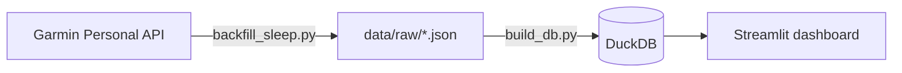

# Garmin Health Hub

Personal health data pipeline and dashboard built on the **Garmin Personal API**. It downloads
my Garmin data, stores it in a local DuckDB database and (soon) visualises it in Streamlit.

**Status:** sleep data pipeline working (<N> nights since October 2025). Next: more metrics and
a dashboard.

## How it works



1. **Extract** (`scripts/backfill_sleep.py`): requests data from the API in 30-day chunks and
   saves each response as-is in `data/raw/`. Safe to re-run: chunks already downloaded are
   skipped, and the most recent chunk is always refreshed.
2. **Transform + load** (`scripts/build_db.py`): reads every raw JSON file, flattens the nested
   structure, removes duplicate nights and rebuilds the table in DuckDB.

## Project structure

```
src/garmin_hub/
├── api.py         # authentication and API requests
├── storage.py     # read/write raw JSON files
├── transform.py   # flatten JSON and add derived columns
├── dates.py       # split date ranges into chunks
└── db.py          # write tables to DuckDB
scripts/
├── backfill_sleep.py   # download sleep history
└── build_db.py         # rebuild the database from raw files
data/                   # raw files and database (git-ignored)
```

## Setup

Requirements: [uv](https://docs.astral.sh/uv/) and a Garmin Personal API key
([create one here](https://connect.garmin.com/app/settings/personalApiToken)).

```bash
uv sync
echo "GARMIN_PERSONAL_API_KEY=your-key" > .env
```

## Usage

```bash
uv run python scripts/backfill_sleep.py   # download / update raw data
uv run python scripts/build_db.py         # rebuild data/garmin.duckdb
```

Query the database:

```bash
uv run python -c "import duckdb; print(duckdb.connect('data/garmin.duckdb').sql('SELECT calendarDate, total_sleep_h, sleepScores_overall_value FROM sleep ORDER BY calendarDate DESC LIMIT 7'))"
```

## Data

### `sleep` table

One row per night. All fields from the API are kept (nested fields are flattened into
`parent_child` column names, lists are stored as JSON text), plus these derived columns:

| Column | Description |
| --- | --- |
| `sleep_start_local` | Bedtime, local clock time |
| `sleep_end_local` | Wake-up time, local clock time |
| `total_sleep_h` | Total sleep in hours |

## API notes

- **Auth:** the API key is exchanged for a JWT access token (valid 24 h, returned as plain
  text) at `/personalapitoken-service/personal-api/personal-api-key/token` with the header
  `Authorization: ApiKey <key>`. Data requests use `Authorization: Bearer <token>`.
- **Sleep endpoint:** `/sleep-service/sleep/dailySleepSummariesByDate?startDate=...&endDate=...`
  accepts up to 30 days per request (60 returns `400`).
- **Dates:** each night is assigned to the day you wake up (`calendarDate`).
- **Timestamps:** milliseconds since epoch. `*Local` timestamps encode local clock time as if
  it were UTC, so they are converted with `tz=UTC` and the timezone is then dropped.
- **History:** the API returns all data since the watch was first used.

## Roadmap

- [x] Authentication with the Personal API
- [x] Sleep pipeline: raw → DuckDB, full history
- [ ] HRV, stress and Body Battery
- [ ] Tests (pytest) and linting (ruff)
- [ ] Streamlit dashboard
- [ ] Analysis: what affects my sleep
- [ ] AI assistant that answers questions about the data
- [ ] Daily automatic updates

## Privacy

This is personal health data. The API key lives in `.env` and all data in `data/`; both are
excluded from git.